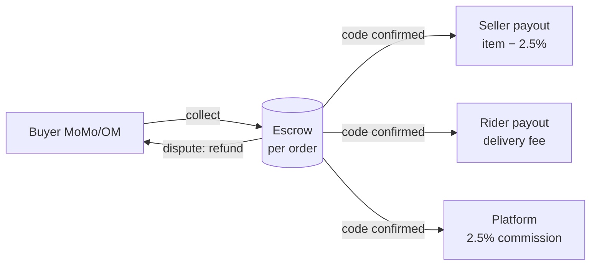

# BayamSafe 🇨🇲

**Mobile-money escrow and delivery for social-commerce sellers in Cameroon.**

A seller on WhatsApp, TikTok or Facebook creates an order in a Telegram bot and sends the buyer a private link. The buyer pays with MTN MoMo or Orange Money, and the money is held in escrow. A moto rider (and, between cities, a bus agency) delivers the parcel. The buyer checks the parcel, then reads a 4-digit code to the rider. Only then are the seller and the riders paid.

| Who | Uses | Can do |
| --- | --- | --- |
| Seller | Telegram bot | Sign up with 1-tap contact share, create orders (same city or inter-city, escrow or cash on delivery), track and cancel orders, apply for the verified badge |
| Buyer | Private checkout link (web) | See the order, drop a GPS pin, add a landmark or 15 s voice note, pay by USSD prompt, see the release code, report a problem |
| Rider | Telegram bot | Apply, go on/off duty, share live location, accept jobs, confirm pickup, record agency drop-off with waybill photo, enter the buyer's code, top up the cash-on-delivery float |
| Admin | Telegram alerts + `/api/admin` | Approve riders and verified badges, resolve disputes, review stuck payouts, check the ledger |

### Pages and flows

- **Landing page** (`/`, [web/index.html](web/index.html)): in French and English, with an interactive escrow simulator and a "how much do fake buyers cost you" calculator. Its buttons open the bot with `?start=merchant` or `?start=rider`.
- **Seller sign-up** (bot, 8 steps): shop name, city, selfie, ID front and back, ID number, shop photo, exact shop GPS pin. Each answer is saved to the database straight away, so an interrupted sign-up resumes where it stopped. Sellers can sell once they submit; the 🏅 badge only appears after admin approval.
- **Rider sign-up** (bot, 9 steps): legal name, selfie, ID front and back, ID number, vehicle type, plate, vehicle photo, city. Approved riders get a public number (e.g. `BSR-7K4Q`) that anyone can check with **`/verify`** in the bot. Buyers also see the rider's photo, plate and number on their checkout page.
- **Admin dashboard** (`/admin`, [web/admin.html](web/admin.html)): money held in escrow, revenue, verification queue with a face-match slider (selfie over ID), orders with dispute and payout actions, live map, riders, sellers and the ledger. Documents are fetched from Telegram on demand; BayamSafe doesn't copy ID photos to its own storage. Admins can also approve or refuse from Telegram review cards.

---

## How the money moves



- **Escrow orders:** the buyer pays item + delivery fee (+ agency fee for inter-city). The seller gets the item price minus the commission. Between cities, the delivery fee is split 50/50 between the first-mile and last-mile riders, and the first-mile rider is reimbursed the agency fee they paid at the counter.
- **Cash on delivery (same city only):** a rider can only accept the job if their **collateral float** covers the item price. That amount is **reserved** while the job runs, so one float can't back two jobs. On delivery the rider keeps the cash, the seller is paid from the rider's float, and the rider keeps the delivery fee.
- **Disputes:** three wrong codes, or a report from the buyer or the rider, freeze the order. An admin either releases the money to the seller or refunds the buyer. Riders keep fees only for legs they actually ran.
- Every money movement is recorded as a balanced **double-entry journal** (`/api/admin/ledger` must always sum to 0).

### Order lifecycle

```
PENDING_PAYMENT → AWAITING_RIDER → RIDER_ASSIGNED → IN_TRANSIT ───────────────────────────────→ DELIVERED → SETTLED
                                                       └→ AT_AGENCY → AT_DESTINATION_HUB → LAST_MILE_ASSIGNED → OUT_FOR_DELIVERY ┘
(any in-transit state) → DISPUTED → REFUNDED | DELIVERED
PENDING_PAYMENT → CANCELLED | EXPIRED          AWAITING_RIDER/RIDER_ASSIGNED → CANCELLED (COD) | REFUNDED (paid)
```

Illegal moves are rejected by the state machine in [order-state.ts](backend/src/domain/order-state.ts).

---

## Security model

- **Buyer link:** `checkout.html#o=<id>&t=<token>`. The token is in the URL fragment, so it never reaches server logs or referrers. Only an HMAC hash of it is stored. A wrong token looks exactly like a missing order.
- **Release code:** stored AES-256-GCM encrypted and shown **only on the device that started the paid payment attempt** (a session token is issued at payment time). The seller has the same link but cannot see the code. For cash-on-delivery orders, anyone with the link can see the code (no buyer money is at risk there).
- **Payments:** Campay webhooks must carry a valid HS256 signature. Even then, the server re-reads the transaction from Campay and checks the amount before marking an order paid. Late, duplicate or wrong-amount payments are never applied automatically; admins are alerted.
- **Payouts:** each payout is marked `SENDING` in the database before the provider is called, so two workers can't send it twice. Failures are retried with backoff. A crash in the middle of a send, or 5 failures, puts the payout in `NEEDS_REVIEW` so an admin can check the Campay dashboard first.
- **Concurrency:** optimistic versioning on orders and riders. When two riders press "Accept" at the same moment, exactly one wins (tested on both stores).
- **Identity:** sign-up only accepts the sender's own Telegram contact. Riders and the verified-seller badge both need admin approval.
- **Production config:** the server refuses to start in production without `APP_SECRET`, `DATABASE_URL`, Campay credentials and the webhook key. It also refuses to start with simulated payments or demo data enabled.
- Also: rate limits on public endpoints, a CSP on the checkout page, all bot output HTML-escaped, and secrets stripped from admin responses.

---

## Project layout

```
backend/
  src/
    domain/      types, state machine, money rules, phone/geo helpers, crypto, agencies
    services/    order (escrow, settlement, disputes, payouts), rider, user, dispatch, events
    payments/    Campay client, simulated gateway, JWT verification
    storage/     Store interface, in-memory store, Postgres store + schema
    api/         Express server (checkout, webhooks, admin), rate limiter
    bot/         Telegram bot (grammY) and notifications
    i18n/        French / English bot texts
  test/          62 tests: domain, full order flows on memory AND Postgres (PGlite), HTTP API, bot
web/checkout.html  buyer page (FR/EN)
```

---

## Running it

Requires Node.js 20+.

```bash
cd backend
npm install
cp .env.example .env        # defaults: in-memory storage, simulated payments, demo data
npm run dev
```

The console prints a demo checkout link. Open it, enter any MTN/Orange number, press pay, then **"Test mode: simulate approval"**.

To use the bot, create one with [@BotFather](https://t.me/BotFather) and set `TELEGRAM_BOT_TOKEN` in `.env`. Add your own Telegram id to `ADMIN_TELEGRAM_IDS` to receive rider/KYC approval buttons and alerts.

### Tests

```bash
cd backend
npm test          # 62 tests, ~25 s (the Postgres suite runs on embedded PGlite, no server needed)
npm run typecheck
```

### With Postgres

```bash
docker compose up --build   # Postgres + app; secrets come from backend/.env
```

Or point `DATABASE_URL` at any Postgres 13+. The schema ([schema.ts](backend/src/storage/schema.ts)) is applied on start (`npm run db:migrate` does it on its own).

### Going live with Campay

1. Create a Campay app and test in the sandbox first (`CAMPAY_BASE_URL=https://demo.campay.net/api`).
2. Set `PAYMENT_PROVIDER=campay`, `CAMPAY_USERNAME`, `CAMPAY_PASSWORD` and `CAMPAY_WEBHOOK_KEY`.
3. In the Campay dashboard, set the webhook URL to `https://<your-domain>/api/webhooks/campay`.
4. Check the request/response field names in [campay.ts](backend/src/payments/campay.ts) against Campay's current API docs. The client is tested against a fake HTTP layer, not against Campay itself.

### Deploying

Any host that runs a Docker image and a Postgres database works (Railway, Render, Fly.io, a VPS). Set `NODE_ENV=production`, a public HTTPS `PUBLIC_URL`, and `TELEGRAM_USE_WEBHOOK=true` with a `TELEGRAM_WEBHOOK_SECRET`. Run **one instance** for now (see limitations).

---

## HTTP API

| Method | Path | Auth | Purpose |
| --- | --- | --- | --- |
| GET | `/api/health` | none | Status, storage and payment mode |
| GET | `/api/track/:trackingCode` | none | Coarse status only |
| GET | `/api/checkout/:orderId` | `X-Buyer-Token` (+ `X-Buyer-Session`) | Buyer view (release code only for the paying device) |
| PATCH | `/api/checkout/:orderId/delivery` | buyer | GPS pin, address, landmark |
| PUT | `/api/checkout/:orderId/voice` | buyer | Voice note (`audio/*`, ≤ 400 KB) |
| POST | `/api/checkout/:orderId/pay` | buyer | Send the USSD payment prompt; returns a session token |
| POST | `/api/checkout/:orderId/dispute` | buyer | Report a problem |
| GET/POST | `/api/webhooks/campay` | signed | Payment notifications |
| POST | `/api/webhooks/telegram` | secret header | Bot updates (webhook mode) |
| * | `/api/admin/...` | `Authorization: Bearer ADMIN_API_KEY` | `orders`, `orders/:id`, `orders/:id/resolve`, `orders/:id/cancel`, `orders/:id/arrived`, `orders/:id/payouts/:pid/review`, `kyc`, `users/:id/kyc`, `riders`, `riders/:id/status`, `ledger` |
| POST | `/api/dev/...` | buyer | Simulated payment approval (simulated provider and non-production only) |

---

## Known limitations / next steps

- **Single instance:** rate limits, bot sessions (the step-by-step order wizard) and the payout lock are in-process. Running several instances needs Redis for those (the database is already safe for concurrent writers).
- **Bot conversation state** is lost on restart, so a seller mid-wizard has to start again. Orders themselves are persisted.
- **Release-code recovery:** if the buyer clears their browser, support has to help them; there's no SMS channel yet. Sending the code by SMS would also close the remaining gap where someone else starts the payment on the buyer's number.
- **Agency terminals** in [agencies.ts](backend/src/domain/agencies.ts) have approximate coordinates and no phone numbers. Confirm them on the ground before launch.
- **Dispatch** scans on-duty riders in memory. That's fine for hundreds of riders; move to PostGIS or Redis geo queries when it isn't.
- **Hub arrival** is marked by the seller (who hears from the agency) or an admin. There's no agency integration.
- **Regulation:** holding customer funds in escrow in CEMAC is regulated (COBAC / BEAC rules on payment services). Get legal advice and a licensed partner before handling real volume.

## License

MIT
