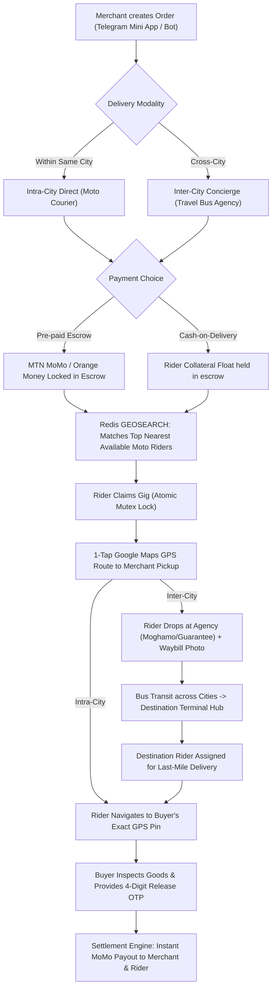

# BayamSafe 🇨🇲
### Unified Social Commerce Escrow, GPS Micro-Logistics & Inter-City Travel Agency Network

[](https://opensource.org/licenses/MIT)
[](https://nodejs.org/)
[](https://www.typescriptlang.org/)
[](https://www.postgresql.org/)
[](https://grammy.dev/)

**BayamSafe** is an all-in-one trust and logistics operating system built specifically for emerging markets and social commerce across Central Africa (Cameroon: Douala, Yaoundé, Bamenda, Buea, Bafoussam).

It combines:
1. **The Fintech Trust Layer**: Zero-fraud escrow payments powered by **MTN Mobile Money (MoMo)** and **Orange Money (OM)** with a cryptographic 4-digit release handshake.
2. **The Micro-Logistics Engine**: On-demand moto rider dispatch via **Redis Geospatial Matching (`GEOSEARCH`)** and **exact GPS pin-drop navigation**.
3. **The Inter-City Agency Concierge**: First-mile collection, hand-off to regional bus lines (*Moghamo Express, Guarantee Express, Buca Voyages*), waybill (*Bordereau*) receipt photo ingestion, and destination last-mile delivery.

---

## 🏗️ High-Level System Architecture



---

## 🌟 Core Features

### 1. Zero-Fraud Digital Escrow & COD Collateral
* **Pre-paid Digital Escrow**: Buyers pay via MTN MoMo or Orange Money USSD push prompts (`*126#` / `#150#`). Funds are held in a secure custodial escrow pool until package delivery and inspection.
* **Cash-on-Delivery (COD) Float Guard**: Riders cannot accept a cash-on-delivery gig unless their in-app wallet maintains collateral float $\ge$ the order amount. When cash is collected, the rider's float is debited, and the merchant is credited instantly, eliminating cash-skimming risks.
* **Cryptographic 4-Digit Release Handshake**: Release codes are securely hashed (HMAC-SHA256). Sellers and riders cannot release funds until the buyer gives the code after opening and inspecting the package.
* **Fair-Split Delivery Fee Protection**: If a customer rejects a package at the door without merchant fault, the moto rider is guaranteed their delivery fee from the buyer's deposit, eliminating wasted delivery expenses for merchants.

### 2. Informal Addressing & Exact GPS Routing
Cameroon neighborhoods rarely have structured street names. BayamSafe bridges this with a triple-redundant address toolkit:
* **Exact Satellite GPS Pin-Drop**: 1-tap browser geolocation (`navigator.geolocation`) down to ±3–5 meters, with an interactive Leaflet map marker.
* **1-Tap Rider Navigation**: Riders tap one button in Telegram to open **Google Maps** with a direct route:
  ```
  https://www.google.com/maps/dir/?api=1&destination=<latitude>,<longitude>
  ```
* **Informal Landmarks & 15s Audio Notes**: Merchants and recipients can attach landmark notes (*"Portail bleu, en face pharmacie du peuple"*) and short voice directions for complex alleys.

### 3. Inter-City Agency Concierge (Bus Travel Lines)
* Pre-seeded with major Cameroonian travel agencies:
  * **Douala**: Moghamo Bonaberi, Guarantee Bassa Ndokoti, Buca Mboppi.
  * **Yaoundé**: Guarantee Mvan, Buca Mvan, Touristique Nsam.
  * **Bamenda**: Moghamo Mile 4 Station.
* **Waybill Photo Upload**: Riders snap a photo of the physical agency waybill receipt (*Bordereau d'expédition*), enabling end-to-end multi-leg transit tracking.

---

## 🗄️ Database Architecture (PostgreSQL + PostGIS)

The database schema (`database/schema.sql`) implements:
* **Double-Entry Financial Ledger**: `accounts`, `journal_entries`, and `postings` table preventing double-spending and guaranteeing strict balance consistency for COBAC/CEMAC banking compliance.
* **PostGIS Spatial Geometries**: High-speed indexing (`GIST`) for pickup locations, drop-off pins, and travel agency terminals.
* **Rider Float Ledger**: Manages rider collateral, `/on_duty` / `/off_duty` statuses, trust ratings, and live coordinates.

---

## 🚀 Getting Started

### Prerequisites
* Node.js v20+ and npm
* Git

### 1. Installation
```bash
git clone https://github.com/achiri/bayam-safe.git
cd bayam-safe/backend
npm install
```

### 2. Run Test Suite
```bash
npm test
```
The automated test suite runs 5 comprehensive scenarios:
* Intra-city delivery with GPS pins & Google Maps routing.
* Redis geospatial rider discovery.
* Atomic mutex lock gig claim.
* 4-digit OTP handshake verification & instant MoMo disburse.
* Inter-city bus agency transit (Douala ➡️ Bamenda) with waybill logging.

### 3. Run the Development Server
```bash
npm run dev
```
* **Mobile Web Checkout & GPS Picker**: `http://localhost:4000/checkout.html`
* **API Health Check**: `http://localhost:4000/api/health`

### 4. Connect a Live Telegram Bot
1. Search for `@BotFather` on Telegram and create a new bot using `/newbot`.
2. Copy your token and paste it into `backend/.env`:
   ```env
   TELEGRAM_BOT_TOKEN=123456789:ABCdefGhIJKlmNoPQRsTUVwxyZ
   ```
3. Restart `npm run dev`. The bot will begin long-polling immediately.

---

## 🌐 Deployment Options (24/7 Cloud)

Because the platform must handle incoming MTN MoMo / Orange Money payment webhooks and Telegram events continuously:

| Platform | Best For | Estimated Cost | Setup Effort |
| :--- | :--- | :--- | :--- |
| **[Railway.app](https://railway.app)** *(Recommended)* | Direct GitHub deployment, automatic HTTPS webhooks, 1-click PostgreSQL | ~$5 / month | 2 minutes |
| **[Render.com](https://render.com)** | Generous free tier, automated git push deploys | Free / $7/mo | 5 minutes |
| **Hetzner Cloud VPS / DigitalOcean** | Production scale, Docker Compose + Caddy SSL | €3.80 - $5 / mo | 15 minutes |

---

## 📡 API Reference

| Method | Endpoint | Description |
| :--- | :--- | :--- |
| `POST` | `/api/orders` | Create an intra-city or inter-city order |
| `GET` | `/api/orders/:code` | Retrieve order status, GPS coordinates, and payment breakdown |
| `POST` | `/api/orders/:code/pay` | Initiate MTN MoMo / Orange Money USSD prompt |
| `POST` | `/api/orders/:code/simulate-payment` | Sandbox endpoint to simulate instant buyer payment approval |
| `POST` | `/api/orders/:code/dispatch` | Assign rider to gig |
| `POST` | `/api/orders/:code/verify-code` | Verify 4-digit release OTP and disburse payouts |
| `POST` | `/api/orders/:code/dispute` | Buyer rejects package; compensates rider and initiates return |
| `POST` | `/api/webhooks/campay` | Webhook listener for payment gateway callbacks |

---

## 📄 License
This project is licensed under the MIT License.
